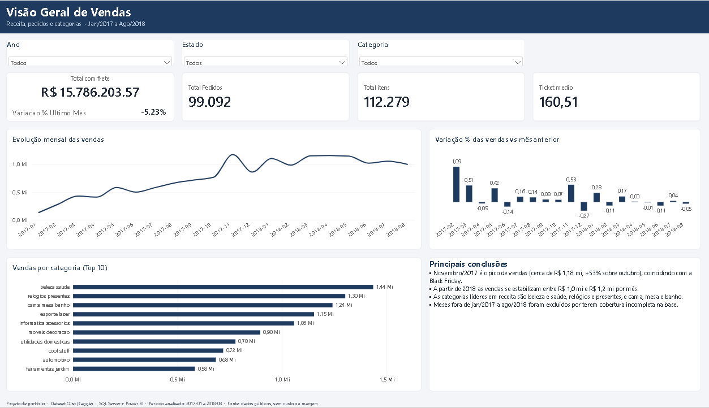
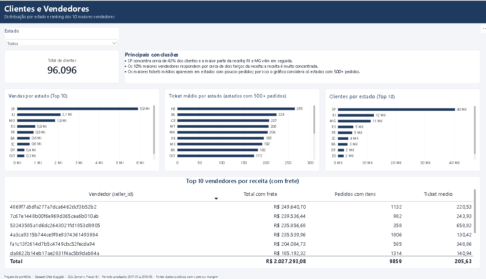
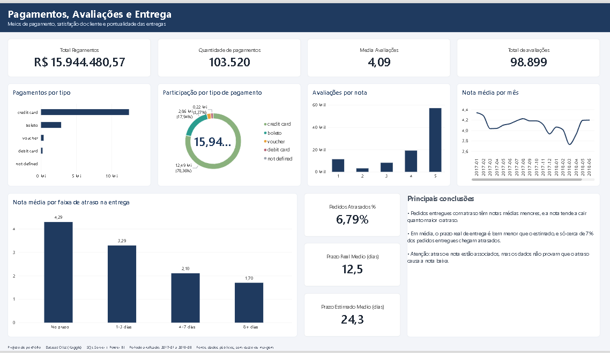
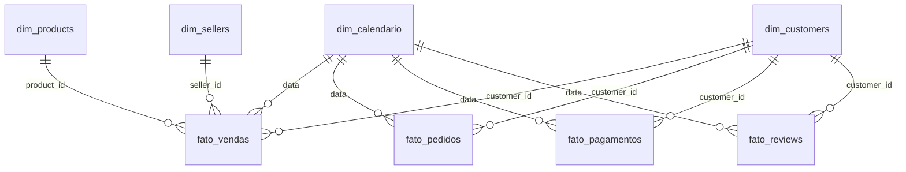

# 🛒 Análise de E-commerce (Olist) — SQL Server + Power BI

Dashboard em Power BI sobre o dataset público de e-commerce da **Olist** (Kaggle), com modelagem dimensional em **SQL Server** e análise de vendas, clientes, vendedores, pagamentos, avaliações e prazo de entrega.

> **Período analisado:** jan/2017 a ago/2018 (meses fora dessa janela foram excluídos por cobertura incompleta na base).

## 📸 Preview

### Visão Geral de Vendas


### Clientes e Vendedores


### Pagamentos, Avaliações e Entrega


## 🎯 Perguntas de negócio respondidas

- Como a receita evoluiu mês a mês e quais meses cresceram ou caíram?
- Quais categorias, estados e vendedores mais geram receita?
- Qual o ticket médio e como ele varia por estado?
- Como os clientes pagam (cartão, boleto, voucher…)?
- Qual a satisfação dos clientes e qual a relação com o **atraso na entrega**?

## 🔎 Principais resultados

| Indicador | Valor |
|---|---|
| Receita (produtos + frete) | R$ 15,79 mi |
| Pedidos | 99.092 |
| Itens vendidos | 112.279 |
| Ticket médio | R$ 160,51 |
| Clientes únicos | 96.096 |
| Nota média das avaliações | 4,09 |
| Pedidos entregues com atraso | 6,79% |
| Prazo real × estimado de entrega | 12,5 × 24,3 dias |

**Insights**

- **Novembro/2017** é um dos picos de vendas (cerca de R$ 1,18 mi, **+53%** sobre outubro), coincidindo com a Black Friday. A partir de 2018 as vendas se estabilizam entre R$ 1,0 mi e R$ 1,2 mi por mês.
- As categorias líderes em receita são **beleza e saúde**, **relógios e presentes** e **cama, mesa e banho**.
- **SP** concentra cerca de **42% dos clientes** e cerca de **37% da receita**; RJ e MG vêm em seguida.
- Entregas atrasadas têm nota média muito menor: **4,29** (no prazo) caindo até **1,70** (atraso de 8+ dias). Os dados mostram associação, **não causalidade**.
- O prazo real de entrega é bem menor que o estimado, e apenas ~7% dos pedidos entregues chegam atrasados.
- Estados com os maiores tickets médios (ex.: PB, PA, CE) têm poucos pedidos; por isso o gráfico considera só estados com 500+ pedidos.

## 🧱 Arquitetura

```
CSVs Olist (Kaggle) ──► SQL Server (schema staging) ──► SQL Server (schema dw) ──► Power BI (Import)
```

- **staging**: tabelas com os CSVs originais do Olist.
- **dw**: modelo dimensional (dimensões e fatos) consumido pelo Power BI.

### Modelo de dados (esquema estrela)



| Tabela | Descrição |
|---|---|
| `fato_vendas` | Itens vendidos (preço, frete, produto, vendedor) |
| `fato_pedidos` | Pedidos e datas do ciclo de entrega |
| `fato_pagamentos` | Pagamentos por tipo e valor |
| `fato_reviews` | Avaliações dos clientes |
| `dim_calendario` | Calendário (ano, trimestre, mês, `ano_mes`…) |
| `dim_customers` · `dim_products` · `dim_sellers` | Dimensões de clientes, produtos e vendedores |

### Principais medidas DAX

| Medida | Lógica |
|---|---|
| `Total com frete` | Valor dos produtos + valor do frete |
| `Ticket medio` | Total com frete ÷ pedidos com itens |
| `Vendas Mes Anterior` / `Variacao % Vendas (MoM)` | Comparação mensal com `DATEADD` |
| `Variacao % Ultimo Mes` | Último mês disponível × mês anterior |
| `Pedidos Atrasados %` | Pedidos entregues após a data estimada ÷ pedidos entregues |
| `Prazo Real Medio (dias)` / `Prazo Estimado Medio (dias)` | Média de dias da compra até a entrega real × estimada |
| `Nota Media (via pedidos)` | Média das avaliações filtrada pelos pedidos (via `TREATAS`) |

Colunas calculadas em `fato_pedidos`: `Status Entrega` (No prazo / Atrasado / Não entregue) e `Faixa de Atraso` (1-3, 4-7, 8+ dias).

## 📂 Estrutura do repositório

```
├── powerbi/                # Projeto Power BI (formato PBIP: modelo em TMDL + relatório em PBIR)
│   ├── projeto_ecomm_v4_visual_v2_2.pbip
│   ├── projeto_ecomm_v4_visual_v2_2.Report/
│   └── projeto_ecomm_v4_visual_v2_2.SemanticModel/
├── sql/
│   └── 01_estrutura_banco.sql   # Criação do banco, schemas e tabelas (DDL)
├── images/                 # Prints das páginas do relatório
└── README.md
```

## ▶️ Como executar

**Requisitos:** Power BI Desktop (versão recente) e SQL Server / SQL Server Express com SSMS.

1. Baixe o dataset [Brazilian E-Commerce Public Dataset by Olist](https://www.kaggle.com/datasets/olistbr/brazilian-ecommerce) no Kaggle.
2. Execute `sql/01_estrutura_banco.sql` no SSMS para criar o banco `Projeto_Ecomm` com os schemas `staging` e `dw`.
3. Importe os CSVs para as tabelas do schema `staging` (SSMS → *Tasks → Import Flat File*) e popule as tabelas do schema `dw` a partir delas.
   > ⚠️ **Nota:** este repositório traz a estrutura das tabelas; os scripts de transformação `staging → dw` ainda não estão incluídos.
4. No Power BI Desktop, habilite **Arquivo → Opções → Recursos de visualização → Projetos do Power BI (.pbip)** e abra `powerbi/projeto_ecomm_v4_visual_v2_2.pbip`.
5. Em **Transformar dados → Configurações da fonte de dados**, troque o servidor `DESKTOP-ATR9NL6\SQLEXPRESS01` pelo seu servidor SQL e clique em **Atualizar**.

## 🛠️ Tecnologias

SQL Server · T-SQL · Power BI · DAX · Power Query (M) · Modelagem dimensional · TMDL/PBIR

## ✅ Boas práticas aplicadas

- Esquema estrela com calendário dedicado e relacionamentos por data e chave.
- Medidas centralizadas em tabela própria (`_Medidas`).
- Tema visual customizado e layout consistente (cabeçalho, filtros, KPIs, gráficos e conclusões em cada página).
- Filtro de período aplicado no nível do relatório e documentado no rodapé.
- Cuidado na interpretação: associação entre atraso e nota não é tratada como causa.

## ⚠️ Limitações

- Dados públicos de um único marketplace, **sem custo ou margem** — a análise é de receita, não de lucro.
- "Total com frete" (vendas) e "Total Pagamentos" diferem ligeiramente (~1%) por serem origens distintas.
- Dataset original sob licença **CC BY-NC-SA 4.0** (uso não comercial); os dados brutos não estão neste repositório.

## 👤 Autor

**[Matheus Meneses]** — [LinkedIn](https://www.linkedin.com/in/meneses-matheus/) · [GitHub](https://github.com/menesesmatheus)
